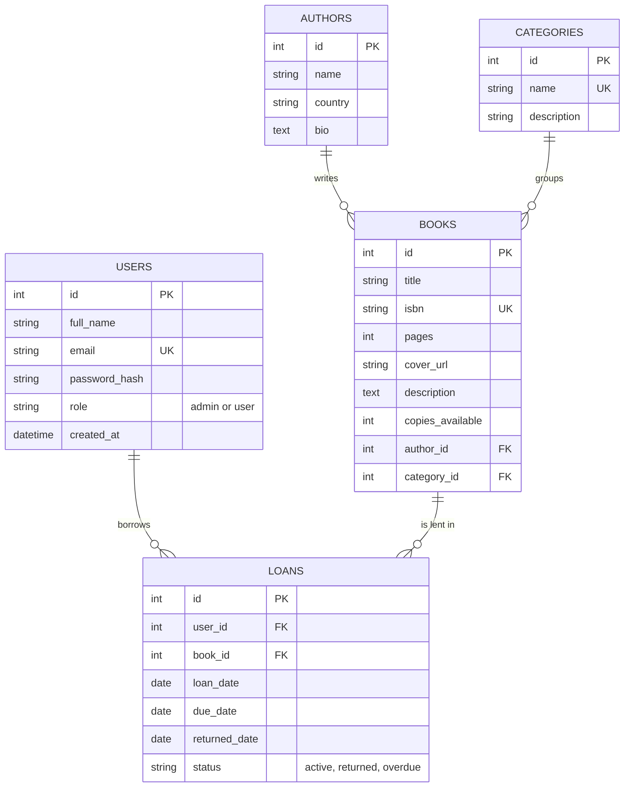

One author writes many books (Authors 1 to N Books).
One category groups many books (Categories 1 to N Books).
One user has many loans (Users 1 to N Loans).
One book appears in many loans (Books 1 to N Loans).
Users and Books are therefore many-to-many through Loans.
